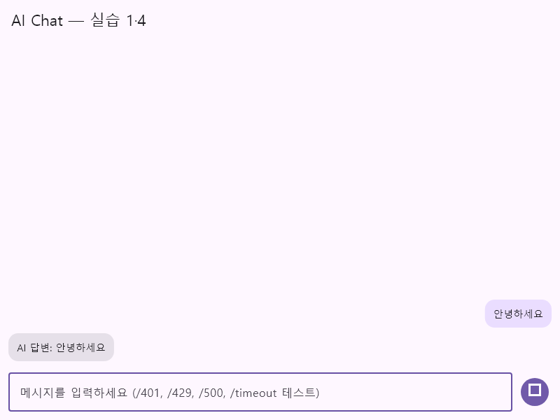

# 11주차 과제 — AI Chat (GAI3008-01)

실습 1 채팅 UI와 실습 4 오류·재시도를 개인 구현한 저장소입니다.

## 실행

```bash
flutter pub get
node proxy/server.mjs
# 새 터미널:
flutter run -d chrome
```

외부 API key 없이 앱 → HTTP proxy → MOCK 응답으로 실행됩니다. `/401`, `/429`, `/500`, `/timeout`은 첫 요청에서 실패하고 같은 메시지를 다시 시도하면 성공합니다. `/timeout`은 실제로 30초 뒤 앱에서 timeout 처리됩니다. 서버 재시작으로 테스트 기록을 초기화합니다.

Android 에뮬레이터: `flutter run --dart-define=CHAT_BASE=http://10.0.2.2:8787`

서버 전체 오류 테스트 (PowerShell): `$env:FORCE_STATUS='429'; node proxy/server.mjs` (종료 후 환경변수 제거). `SLOW_MS`로 응답 지연을 설정할 수 있습니다. 실제 AI 연결 및 키는 이번 mock 실행에 필요하지 않습니다.

앱은 빈 대화에서 시작합니다. 429 오류 후 수동 재시도는 첫 번째 1초, 그다음 2초 대기합니다. 운영체제 Reduce Motion 설정을 따릅니다.

## 구현 체크리스트

- [x] 사용자/AI 말풍선 좌우 정렬
- [x] 빈 상태 `무엇이든 물어보세요`
- [x] 입력창·전송 버튼·키보드 대응
- [x] sending/typing/done/error 흐름
- [x] 타이핑 점 3개와 `AnimatedList` 250ms 삽입
- [x] 401/429/500/timeout 오류와 다시 시도
- [x] 429 retry 지수 backoff 1초 → 2초
- [x] Reduce Motion에서 애니메이션만 비활성화

## 화면 증거

Flutter 위젯을 실제 렌더링한 화면입니다 (자동 캡처).



## 단계별 커밋

| 단계 | 내용 | 커밋 |
|---|---|---|
| 1 | 채팅 UI 완성 | `feat: complete chat ui lab 1` |
| 2 | 상태·애니메이션·오류·재시도 | `feat: add chatbot states and animated replies` |
| 3 | 제출 기록·검증 | `feat: add error retry and assignment evidence` |

## 제출

- 저장소 URL
- 커밋 목록 URL: `/commits/main/`
- `docs/w11.md` 5칸 기록
- 개선된 화면 캡처 또는 GIF
